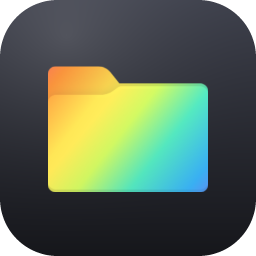

<div align="center">



# 文件夹标记 · FolderMarker


**让文件管理更直观，更高效。** 给 Windows 文件夹加一个「文件夹标记」右键菜单，用 7 种颜色快速分类与识别，打造更清晰有序的工作空间。

| 多种颜色 | 快速操作 | 右键菜单 | 轻量简洁 |
|:---:|:---:|:---:|:---:|
| 一键标记 | 高效管理 | 随时使用 | 专注实用 |

</div>


## 亮点

- **原生观感**：基于系统原生文件夹图标换色，不是重绘替代品；渐变、阴影、标签页细节全保留
- **即时生效**：点完不到半秒变色，已打开的窗口也会重绘；不弹窗、不闪命令行
- **内容预览保留**：带照片/视频的文件夹只染外壳，缩略图预览原样保留
- **颜色自由**：7 种预设色 + 系统取色器自定义色，还能一键「恢复上次颜色」
- **自动跟随**：守护进程开机自启，内容变化自动重画；跨电脑 / 网络共享盘同步标记
- **管理台**：Win11 设置页风格界面，批量改色、搜索筛选、共享盘同步、日志一目了然

## 安装

双击 `dist\FolderMarker-setup-v2.4.4.exe`，标准中文向导。安装时会弹一次 UAC（写受信任根证书 + 注册应用包），点「是」即可。
安装位置：`%LOCALAPPDATA%\FolderMarker`；在「设置 → 应用 → 已安装的应用」里卸载。

## 使用

在资源管理器里**右键选中一个文件夹** → 第一层菜单「文件夹标记」→ 挑颜色（红/橙/黄/绿/蓝/紫/灰）或「清除标记」。
点完不到半秒生效，已打开的窗口也会重绘，不弹窗、不闪命令行。

文件夹的「修改日期」最多被挪动 2~4 秒（资源管理器只显示到分钟，看不出来）——这是让缩略图缓存失效、立刻换色的必要手段。

右键 →「文件夹标记 → 管理…」打开管理台：标记清单（搜索/筛选/批量改色/清色/图标预览/拖入即标）、守护进程、共享盘同步、日志、设置、关于。

## 命令行

程序在 `%LOCALAPPDATA%\FolderMarker\FolderMarker.exe`，全部支持命令调用：

| 命令 | 作用 |
|---|---|
| `set <颜色> "<文件夹>"` | 标记/换色，颜色：`red orange yellow green blue purple gray` |
| `set c3a7bd0 "<文件夹>"` | 自定义颜色（`c` + 6 位 RGB） |
| `clear none "<文件夹>"` | 清除标记，还原属性/时间戳/原有图标 |
| `undo` | 恢复上次颜色 |
| `cleanup none` | 批量还原所有已标记文件夹（卸载前调用） |
| `refresh none` / `refresh none force` | 巡检一次 / 强制全部重画 |
| `import "<共享盘根>"` | 导入别的电脑标好的文件夹并生成本机缓存 |
| `tray` | 常驻托盘（快速入口、暂停/恢复巡检、退出） |
| `diagnose "<文件夹>"` | 输出 ini / 缓存 / 图标判定全状态 |
| `selftest` | 39 项回归自检 |

## 构建

clone 后只需一个脚本，全自动：

```powershell
git clone https://github.com/ZetlHNem/FolderMarker.git
cd FolderMarker
powershell -ExecutionPolicy Bypass -File .\build_all.ps1
```

`build_all.ps1` 会自动完成：

1. 从 `tools\zig010.whl` 解出 zig（含 `lib`），从 `tools\sdktools.zip` 解出 `mt.exe / makeappx.exe / signtool.exe`；已解压则跳过
2. 编译 `build\FolderMarker.exe`（348 KB），并把 `icons\` 复制到 `build\`
3. 跑 `selftest`，标准结果 **39 通过 / 0 失败**
4. 编译原生 COM DLL、嵌入清单、打包签名 `dist\FolderMarkerShell.msix`（约 212 KB）
5. 检测到 Inno Setup 7 时，自动打 `dist\FolderMarker-setup-v2.4.4.exe`（约 2.9 MB）；没装则跳过安装包，其余照常完成

**前置条件**：Windows + 系统自带 .NET Framework 4.6.2+（无需 Visual Studio / .NET SDK）。
Inno Setup 7 只影响最后的安装包步骤，不装也能生成 EXE 和 MSIX。
手动分步：`.\build_exe.ps1` → `.\build_msix.ps1` → `ISCC.exe FolderMarker.iss`。

自签名证书 `CN=FolderMarker` 在 `Cert:\CurrentUser\My`，私钥 `build\FolderMarker.pfx` **绝不入版本库**。
换证书后要同步更新 `FolderMarker.iss` 里 `RemoveShellExtension` 的指纹。

## 项目结构

```
FolderMarker/
├─ src/
│  ├─ core/   入口、图标、巡检、命令、规则等（Program partial，均已去冗余前缀）
│  ├─ ui/     WPF 管理台、颜色选择器、WinUI 视觉规格
│  ├─ shell/  右键菜单 COM 扩展（shell_native.c / shell.manifest）
│  └─ _backup/ 本地 .bak 备份，不入库、不参与编译
├─ icons/          7 色文件夹图标 + app.ico + menu.ico
├─ packaging/      sparse 包清单 + logo + 安装向导 bmp
├─ tools/          图标生成/诊断脚本 + zig010.whl + sdktools.zip
├─ FolderMarker.iss     Inno Setup 安装脚本
├─ build_all.ps1        一键构建（推荐入口）
├─ build_exe.ps1        只编译主程序
└─ build_msix.ps1       编译原生扩展 + 打包签名 MSIX
```

`tools/gen/` 下是图标/品牌图生成脚本；`tools/build_probe.ps1` 等是诊断用。
体检脚本 `build/audit.py`、`build/audit2.py` 在本地保留（不入库），覆盖中文/空格/特殊字符路径、并发、权限拒绝、超长路径、卸载清理。

改颜色：编辑 `tools/tint_icons.py` 的 `COLORS` / `GRAY_FACTOR`，再跑脚本重新生成 ico；应用图标用 `tools/gen/gen_app_icon.py`。改完重新构建即可。

## 实现要点

- **为什么不用自己写 desktop.ini**：实测直接写 ini 加各种通知 API 都不变色——资源管理器按文件夹缓存外观，连 F5 都不重读。只有 `SHGetSetFolderCustomSettings(FCSM_ICONFILE, FCS_FORCEWRITE)` 能强制刷新，这是唯一让已打开窗口立刻重绘的入口。
- **图标不写进被标记的文件夹**：`desktop.ini` 指向 `%LOCALAPPDATA%\FolderMarker\cache\<hash>-<颜色>.ico`，每台电脑各自生成本机缓存，可跨电脑/网络共享盘同步。普通文件夹直接用内置的纯色 ico，不产生缓存文件。
- **自带图标/带内容预览的文件夹只染外壳**：从 `imageres.dll` 取壳做参照，逐像素分类壳与内容，只把壳的色相换成目标色；内容、卡片、位置全部来自 Windows 原图。抓不到原版缩略图时退回纯色 ico。
- **不留痕迹**：标记前记下时间戳和属性写进 `[FolderMarkerState]`，清除时整份还原；`ReadOnly` 换成功能等价但不显眼的 `System`；用户原有的 `InfoTip` / `IconArea_Image` 保留。
- **超长路径**：显式声明 .NET Framework 4.6.2 + 文件系统调用统一补 `\\?\` 前缀，支持 260+ 字符路径。
- **Win11 主菜单**：主菜单只加载带包身份的 `IExplorerCommand`，纯注册表写法一律被收进「显示更多选项」。所以用原生 COM + sparse MSIX 包，证书必须装进**本机**根存储（AppX 部署服务跑在 SYSTEM 上下文）。Win10 自动退回传统注册表菜单。
- **守护进程**：登录自启，开机强制全量重画一次，之后每 60 秒巡检；`FileSystemWatcher` 让本地盘内容变化 0.5~1 秒内更新（轮询兜底网络盘）。共享盘根按 `roots.txt` 定期扫（小根 5 分钟，>2 秒的慢扫描自动拉长到 30 分钟）。

## 已知限制

- 每个 Windows 用户都要装一次（程序在 `%LOCALAPPDATA%`，MSIX 是 per-user 注册）。
- 安装必须有一次 UAC；卸载时还原的只是 `marked.txt` 里记录过的文件夹（v1.4.1 之前标记的不在清单里）。
- 两台电脑都要装、且都用默认目录，`%LOCALAPPDATA%` 才能各自展开到正确缓存路径。
- 新机器跑一次 `import <共享盘根>` 后新增标记/换色/内容变化全自动跟上；给最深的那层根最省（195 目录 ≈ 1.2 秒，8407 目录 ≈ 10.8 秒）。
- 内容预览是「第一个图片/视频」的缩略图快照，最长约一分钟延迟（可手动 `refresh none force`）。
- 守护进程是登录自启的无窗口程序，任务管理器要在「详细信息」页找带 `watch` 命令行参数的 `FolderMarker.exe`。
- 升级后建议重新标记一次旧版本留下的文件夹，以接入自动巡检。

## 第三方图标来源

- `icons/palette.ico`：基于 [Fluent UI System Icons](https://github.com/microsoft/fluentui-system-icons) 的 `color-24-regular`，MIT License，Copyright (c) Microsoft Corporation。
- 其余 `icons/*.ico` 为本项目自绘。

## 许可

本项目采用 [MIT License](LICENSE)。`tools/zig010.whl`（Zig）和 `tools/sdktools.zip`（Microsoft Windows SDK）为各自的第三方工具，按其原许可分发，仅用于本地构建，不属于本项目源码。
